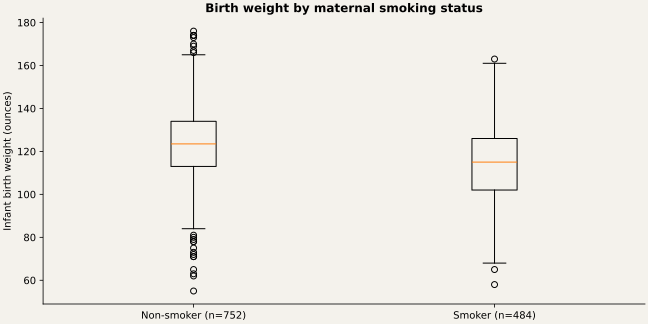

# Maternal Birthweight Analysis

Report-aligned SAS reconstruction exploring birth weight, smoking, gestation, and maternal age.

## The question

How do birth weights vary with maternal smoking and age groups, and what associations appear among maternal measurements?

## Approach

Reconstructed from the report screenshots and supplied 1,236-row CSV. Source collaborators: Abhinav Tanwar, Devadharshini Udayakumar, and Prithwiraj Chatterjee. This repository records collaborative work and does not claim sole authorship. See docs/report-reconciliation.md for exact reproduction checks and interpretation limits.

## Findings

The report-aligned analysis reproduces the main test statistics. Mean birth weight is 119.5769 ounces; the comparison with 118 gives p=0.002416. The smoking-group Welch test gives t=8.6398 (p<0.0001); smoking–parity association p=0.753378; age-group ANOVA p=0.538677. These are observational associations, with the report's single-imputation assumptions preserved.

See `validation/results.md` for full numeric evidence.

## Run in SAS

Requires SAS 9.4 with SAS/STAT and ODS Graphics (or an equivalent licensed SAS Studio environment).

1. Download/clone this repository.
2. Set `project_root` in `src/config.sas` to its absolute directory.
3. Open `run.sas`. If SAS is not started in the repository directory, change its first `%include` to the absolute path to `src/config.sas`.
4. Submit the whole program. The HTML report is written to `outputs/analysis.html`.
5. Review the SAS log for errors and warnings before interpreting results.

## Repository guide

- `src/analysis.sas`: analysis procedures and explanatory comments.
- `src/config.sas`: one root-path setting and shared execution checks.
- `data/`: analysis inputs and schema/provenance notes.
- `docs/`: methods and recovery decisions.
- `validation/`: independent numerical checks when inputs are available.

## Validation status

Independent calculations are documented in `validation/results.md`. SAS runtime execution is pending because SAS is not installed in the preparation environment.

## Authorship and provenance

Analysis supplied by Abhinav Tanwar; packaging and source recovery are documented in `docs/provenance.md`. These are analytical portfolio projects. No employer affiliation or production deployment is implied. Data retain their original ownership; no dataset license is invented.
